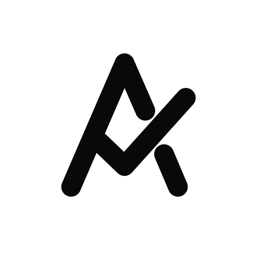
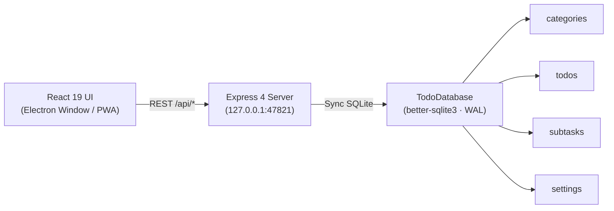
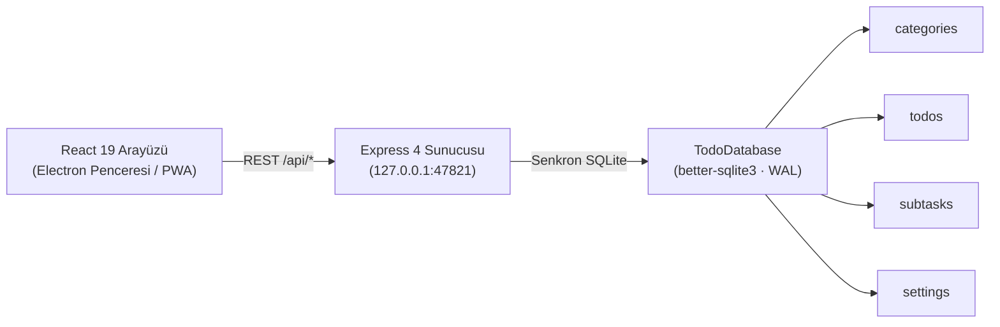

<div align="center">

<a href="https://vellium.dev" target="_blank" rel="noopener noreferrer">
  
</a>

<br /><br />

# ✦ Agendamea - Offline-First Minimalist Task & Daily Planner

</div>

---

<div align="center">

[](#english-version)
&nbsp;&nbsp;&nbsp;&nbsp;
[](#turkish-version)

</div>

---

<div align="center">


</div>

---

<a id="english-version"></a>
# English Version

<div align="center">
  
  <h3>Agendamea - Fast, Offline-First Windows Task &amp; Daily Planner</h3>
  <p><em>Local-First SQLite Architecture, Instant Persistence, and 14 Dual-Mode Color Themes</em></p>
  <p><strong>Developed &amp; Published by <a href="https://vellium.dev">Vellium</a></strong></p>
</div>

<br>

## 💻 Project Overview

**Agendamea** is an offline-first, local-first task manager and daily planner built for **Windows Desktop (Electron 45)** and **Progressive Web App (PWA)** environments using **React 19**, **TypeScript 7**, **Express 4**, and **SQLite (`better-sqlite3`)**.

Designed around zero-friction daily planning, **Agendamea** persists every edit - task creation, subtask toggling, drag-and-drop reordering, category pinning, and theme selection - instantly to a local **WAL-mode SQLite** database. No cloud accounts, no internet connection, and no external telemetry are required.

---

## 🚀 Key Features

- **Offline-First SQLite Engine (`better-sqlite3`)**:
 - Runs with `journal_mode = WAL`, `foreign_keys = ON`, and `busy_timeout = 5000`.
 - Versioned schema migrations via `PRAGMA user_version` (currently `v3`).
 - Full JSON **Export & Import** (`/api/export`, `/api/import`) with strict payload limits and validation.
- **Native Windows Desktop (Electron 45) + PWA**:
 - **Single-Instance Lock**: Prevents duplicate windows and database lock collisions (`app.requestSingleInstanceLock()`).
 - **Deterministic Local Port (`47821`)**: Binds to `127.0.0.1` on Windows to preserve `localStorage` anti-FOUC theme caching across restarts.
 - **Installable PWA**: Configured with `vite-plugin-pwa`, Workbox asset caching, and quick app shortcuts (`New Task`, `Today`, `Important`).
- **Smart Views, Priorities & Subtasks**:
 - Built-in smart views (`All`, `Today`, `Important`, `Completed`), custom categories with color pickers & pinning, `low` / `normal` / `high` priorities, `YYYY-MM-DD` due dates, inline subtasks, and manual drag-and-drop sorting.
- **Soft-Delete Trash & Recovery**:
 - Deleted tasks and categories move to a recoverable Trash bin with one-click restore or permanent purge (`/api/trash`).
- **14 Dual-Mode Color Themes (28 Palettes)**:
 - `Obsidian`, `Slate`, `Navy`, `Blue`, `Cyan`, `Purple`, `Red`, `Orange`, `Yellow`, `Emerald`, `Grass`, `Lime`, `Pink`, and `Indigo` - each with curated `light` and `dark` tokens.
- **Hardened Localhost Security**:
 - Sets `X-Content-Type-Options: nosniff`, `X-Frame-Options: SAMEORIGIN`, `Referrer-Policy: no-referrer`, `Permissions-Policy`, and allowlists external navigation (`vellium.dev`, `github.com`).

---

## 🛠️ Tech Stack

<div align="center">


</div>

### Desktop & Local Backend
- **Electron 45 & electron-builder 26**: Windows x64 NSIS installer, single-instance lock, and custom frameless window controls
- **Express 4 & Node.js**: Loopback REST API (`127.0.0.1:47821`) serving SPA assets and JSON endpoints
- **better-sqlite3 13**: Synchronous, high-throughput SQLite storage with WAL journaling and `user_version` migrations

### Frontend & UI
- **React 19 & TypeScript 7**: Modular component architecture with `ErrorBoundary`, `QuickAddBar`, `TodoDetailPanel`, `Sidebar`, and `SettingsModal`
- **Tailwind CSS v4 & `themes.ts`**: 14 dual-mode CSS token palettes with anti-FOUC caching
- **Vite 8 & `vite-plugin-pwa`**: Fast bundling and offline Workbox service worker

---

## 📁 Project Structure

```tree
Agendamea/
├── electron/
│   ├── main.cjs                    # Electron main process, single-instance lock & server spawn
│   └── preload.cjs                 # Secure IPC preload bridge
├── electron-resources/             # NSIS installer icons, bitmaps & custom .nsh script
├── public/
│   ├── icons/                      # Multi-resolution Web, Apple & Windows tile icons
│   └── logos/                      # Agendamea SVG/PNG brand marks (dark & light)
├── scripts/
│   ├── start-app.bat               # Windows local app & server launcher
│   ├── build-windows.bat           # Automated Windows NSIS .exe builder
│   ├── build-server.mjs            # esbuild server bundler (dist-server/server.mjs)
│   ├── generate-icons.mjs          # Sharp-based multi-platform icon generator
│   ├── generate-installer-assets.mjs
│   └── create-windows-shortcut.ps1
├── src/
│   ├── api/client.ts               # Typed REST API client
│   ├── components/                 # Sidebar, QuickAddBar, TodoItem, TodoDetailPanel, SettingsModal...
│   ├── db/database.ts              # TodoDatabase (SQLite WAL, migrations, CRUD, export/import)
│   ├── hooks/                      # useOnlineStatus, useToast, useTodayDate, useDelayedFocus
│   ├── utils/
│   │   ├── themes.ts               # 14 dual-mode theme palettes (light & dark tokens)
│   │   ├── todoLogic.ts            # Pure task filtering, sorting & date helpers
│   │   └── todoLogic.test.ts       # Unit tests (node:test via tsx)
│   ├── App.tsx                     # Root application state & layout
│   ├── main.tsx                    # React 19 entry point
│   └── types.ts                    # Shared domain types (Todo, Category, Subtask, AppSettings)
├── server.ts                       # Express loopback API & static server
├── electron-builder.yml            # Windows NSIS x64 packaging config (dev.vellium.agendamea)
├── vite.config.ts                  # Vite 8 + Tailwind v4 + VitePWA configuration
└── package.json                    # Scripts & dependencies
```

---

## ⚙️ Architecture & Storage Schema



### SQLite Tables (`PRAGMA user_version = 3`)

| Table | Purpose |
| :--- | :--- |
| `categories` | User-defined lists with custom hex color, `pinned` flag, `sort_order`, and `deleted_at` |
| `todos` | Tasks with `priority` (`low`/`normal`/`high`), `due_date`, `important`, `pinned`, `notes`, and soft-delete |
| `subtasks` | Ordered checklist items linked to `todos` via foreign key cascade |
| `settings` | Persisted `themeMode`, `themeId`, `dragLocked`, `sidebarCollapsed`, and `themeCustomized` |

---

## 🚀 Installation & Usage

### Prerequisites
- **Node.js**: Version `20+`
- **npm** (or **Bun**)

### Step-by-Step Developer Setup

1. **Clone the Repository:**
   ```bash
   git clone https://github.com/emirtdede/Agendamea.git
   cd Agendamea
   ```

2. **Install Dependencies:**
   ```bash
   npm install
   ```

3. **Run Tests & Type-Check:**
   ```bash
   npm test
   npm run lint
   ```

4. **Start Development Mode:**
   ```bash
   # Web / API dev server (http://localhost:3000)
   npm run dev

   # Electron desktop mode
   npm run electron:dev
   ```

5. **Build Windows Installer (NSIS x64):**
   ```bash
   npm run dist:win
   ```

**Official Website**: [Vellium.dev](https://vellium.dev) &bull; **Support**: `support@vellium.dev` &bull; **Publisher**: Vellium

---

<br>

---

<a id="turkish-version"></a>
# Türkçe Versiyon

<div align="center">
  
  <h3>Agendamea - İnternetsiz Çalışan Sade ve Hızlı Windows Görev Yöneticisi</h3>
  <p><em>Yerel Öncelikli SQLite Mimarisi, Anlık Kayıt ve 14 Çift Modlu Renk Teması</em></p>
  <p><strong>Geliştirici ve Yayıncı: <a href="https://vellium.dev">Vellium</a></strong></p>
</div>

<br>

## 💻 Project Overview (Proje Genel Bakışı)

**Agendamea**, **React 19**, **TypeScript 7**, **Express 4** ve **SQLite (`better-sqlite3`)** ile geliştirilmiş; hem **Windows Masaüstü (Electron 45)** hem de **PWA** olarak çalışan, tamamen çevrimdışı öncelikli (offline-first) günlük görev ve ajanda yöneticisidir.

Sıfır sürtünmeli günlük planlama için tasarlanan **Agendamea**, oluşturduğunuz görevlerden alt görevlere, sürükle-bırak sıralamadan tema tercihine kadar her değişikliği anında yerel **WAL modlu SQLite** veritabanına kaydeder. Bulut hesabı, internet bağlantısı veya telemetri gerektirmez.

---

## 🚀 Key Features (Önemli Özellikler)

- **Çevrimdışı Öncelikli SQLite Motoru (`better-sqlite3`)**:
 - `journal_mode = WAL`, `foreign_keys = ON` ve `busy_timeout = 5000` ayarlarıyla yüksek kararlılık.
 - `PRAGMA user_version` (`v3`) üzerinden güvenli şema göçleri.
 - Katı doğrulama ve boyut sınırlarıyla tam JSON **Dışa / İçe Aktarma** (`/api/export`, `/api/import`).
- **Yerel Windows Masaüstü (Electron 45) + PWA**:
 - **Tekil Örnek Kilidi (`requestSingleInstanceLock`)**: Çift pencere açılmasını ve veritabanı çakışmasını engeller.
 - **Sabit Yerel Port (`47821`)**: Windows'ta `127.0.0.1` üzerinde çalışarak `localStorage` tema önbelleğini yeniden başlatmalarda korur.
 - **Kurulabilir PWA**: `vite-plugin-pwa`, Workbox önbellekleme ve hızlı kısayollar (`Yeni Görev`, `Bugün`, `Önemli`).
- **Akıllı Görünümler, Öncelikler ve Alt Görevler**:
 - `Tümü`, `Bugün`, `Önemli`, `Tamamlananlar` akıllı görünümleri; renk seçicili ve sabitlenebilir kategoriler; `düşük` / `normal` / `yüksek` öncelikler; `YYYY-AA-GG` bitiş tarihleri; alt görevler ve sürükle-bırak sıralama.
- **Çöp Kutusu & Geri Yükleme**:
 - Silinen görev ve kategoriler geçici olarak Çöp Kutusu'na taşınır; tek tıkla geri yüklenebilir veya kalıcı olarak temizlenebilir (`/api/trash`).
- **14 Çift Modlu Renk Teması (28 Palet)**:
 - `Siyah (Obsidian)`, `Gri`, `Lacivert`, `Mavi`, `Camgöbeği`, `Mor`, `Kırmızı`, `Turuncu`, `Sarı`, `Zümrüt`, `Çimen`, `Limon`, `Pembe` ve `Çivit` - her biri aydınlık (`light`) ve karanlık (`dark`) varyantlarıyla.
- **Güçlendirilmiş Yerel Güvenlik**:
 - `X-Content-Type-Options: nosniff`, `X-Frame-Options: SAMEORIGIN`, `Referrer-Policy: no-referrer`, `Permissions-Policy` başlıkları ve yalnızca izinli dış bağlantılar (`vellium.dev`, `github.com`).

---

## 🛠️ Tech Stack (Teknoloji Yığını)

<div align="center">


</div>

### Masaüstü ve Yerel Arka Uç
- **Electron 45 & electron-builder 26**: Windows x64 NSIS kurulum paketi, tekil süreç kilidi ve özel çerçevesiz pencere kontrolleri
- **Express 4 & Node.js**: SPA dosyalarını ve JSON API uç noktalarını sunan yerel sunucu (`127.0.0.1:47821`)
- **better-sqlite3 13**: WAL günlüklemeli ve `user_version` sürüm takipli senkron SQLite motoru

### Ön Yüz ve Arayüz
- **React 19 & TypeScript 7**: `ErrorBoundary`, `QuickAddBar`, `TodoDetailPanel`, `Sidebar` ve `SettingsModal` ile modüler arayüz
- **Tailwind CSS v4 & `themes.ts`**: Anti-FOUC önbellekli 14 çift modlu tema paleti
- **Vite 8 & `vite-plugin-pwa`**: Hızlı derleme ve çevrimdışı Workbox service worker

---

## 📁 Project Structure (Proje Klasör Yapısı)

```tree
Agendamea/
├── electron/
│   ├── main.cjs                    # Electron ana süreci, tekil kilit ve sunucu başlatma
│   └── preload.cjs                 # Güvenli IPC preload köprüsü
├── electron-resources/             # NSIS kurulum ikonları, görselleri ve installer.nsh
├── public/
│   ├── icons/                      # Web, Apple ve Windows kutucuk ikonları
│   └── logos/                      # Agendamea SVG/PNG marka logoları (koyu & açık)
├── scripts/
│   ├── start-app.bat               # Windows yerel uygulama ve sunucu başlatıcı
│   ├── build-windows.bat           # Otomatik Windows NSIS .exe derleyici
│   ├── build-server.mjs            # esbuild sunucu derleyicisi (dist-server/server.mjs)
│   ├── generate-icons.mjs          # Sharp tabanlı çoklu platform ikon üreticisi
│   ├── generate-installer-assets.mjs
│   └── create-windows-shortcut.ps1
├── src/
│   ├── api/client.ts               # Tiplenmiş REST API istemcisi
│   ├── components/                 # Sidebar, QuickAddBar, TodoItem, TodoDetailPanel, SettingsModal...
│   ├── db/database.ts              # TodoDatabase (SQLite WAL, migration, CRUD, export/import)
│   ├── hooks/                      # useOnlineStatus, useToast, useTodayDate, useDelayedFocus
│   ├── utils/
│   │   ├── themes.ts               # 14 çift modlu tema paleti (light & dark tokenları)
│   │   ├── todoLogic.ts            # Görev filtreleme, sıralama ve tarih yardımcıları
│   │   └── todoLogic.test.ts       # Birim testleri (tsx üzerinden node:test)
│   ├── App.tsx                     # Ana uygulama durumu ve düzeni
│   ├── main.tsx                    # React 19 giriş noktası
│   └── types.ts                    # Paylaşılan veri tipleri (Todo, Category, Subtask, AppSettings)
├── server.ts                       # Express yerel API ve statik dosya sunucusu
├── electron-builder.yml            # Windows NSIS x64 paketleme ayarları (dev.vellium.agendamea)
├── vite.config.ts                  # Vite 8 + Tailwind v4 + VitePWA yapılandırması
└── package.json                    # Scriptler ve bağımlılıklar
```

---

## ⚙️ Mimari ve Veritabanı Şeması



### SQLite Tabloları (`PRAGMA user_version = 3`)

| Tablo | Amaç |
| :--- | :--- |
| `categories` | Özel HEX renkli, sabitlenebilir (`pinned`), sıralanabilir ve geri dönüştürülebilir listeler |
| `todos` | `low`/`normal`/`high` öncelikli, `due_date` tarihli, notlu ve geçici silmeli görevler |
| `subtasks` | `todos` tablosuna foreign key cascade ile bağlı sıralı alt görevler |
| `settings` | Kalıcı `themeMode`, `themeId`, `dragLocked`, `sidebarCollapsed` ve `themeCustomized` ayarları |

---

## 🚀 Installation & Usage (Kurulum ve Kullanım)

### Gereksinimler
- **Node.js**: Sürüm `20+`
- **npm** (veya **Bun**)

### Adım Adım Geliştirici Kurulumu

1. **Depoyu Klonlayın:**
   ```bash
   git clone https://github.com/emirtdede/Agendamea.git
   cd Agendamea
   ```

2. **Bağımlılıkları Yükleyin:**
   ```bash
   npm install
   ```

3. **Testleri ve Tip Kontrolünü Çalıştırın:**
   ```bash
   npm test
   npm run lint
   ```

4. **Geliştirici Modunda Başlatın:**
   ```bash
   # Web / API geliştirici sunucusu (http://localhost:3000)
   npm run dev

   # Electron masaüstü modu
   npm run electron:dev
   ```

5. **Windows Kurulum Paketini Derleyin (NSIS x64):**
   ```bash
   npm run dist:win
   ```

**Resmi Web Sitesi**: [Vellium.dev](https://vellium.dev) &bull; **Destek**: `support@vellium.dev` &bull; **Yayıncı**: Vellium
